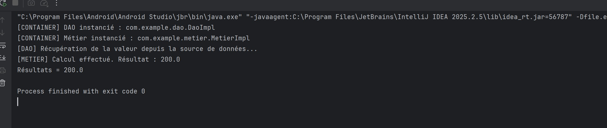
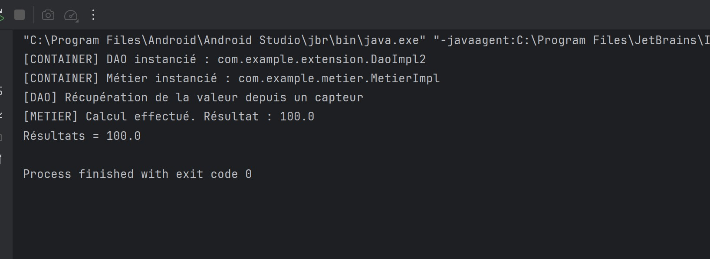

# TP1 — Injection de dépendances en Java

## Implémentation avec une base de données simulée

`DaoImpl` simule la récupération d’une valeur depuis une base de données et le calcul renvoie **200.0**.

## Implémentation avec un capteur simulé

`DaoImpl2` simule la récupération d’une valeur depuis un capteur et le calcul renvoie **100.0**.

